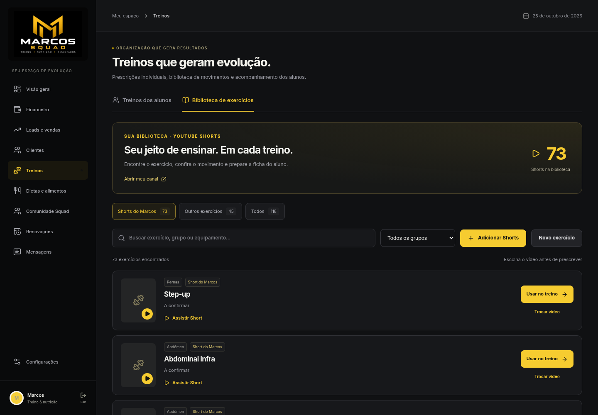
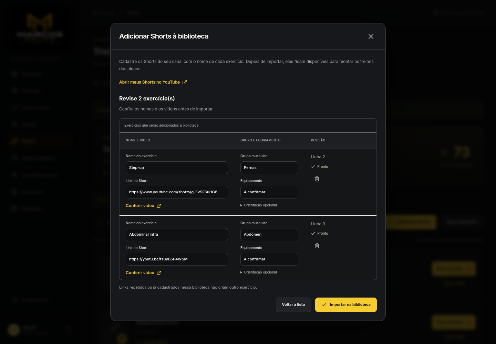
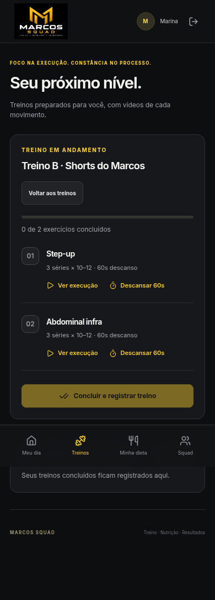

# Biblioteca de exercícios com Shorts — 26/10/2026

A biblioteca inicial reúne **73 Shorts confirmados** do canal [Marcos Paulo Treinador](https://www.youtube.com/@marcosmoura.treinandor7/shorts). Os 45 exercícios anteriores foram preservados; a biblioteca inicial tem 118 exercícios ao todo. Os 591 alimentos TACO continuam disponíveis na área de alimentação.

## Usar os vídeos nos treinos

1. Abra **Treinos → Biblioteca de exercícios**. A lista “Shorts do Marcos” aparece primeiro.
2. Busque o nome do exercício, grupo ou equipamento. Use os filtros de origem e grupo para reduzir a lista.
3. Clique em **Assistir Short** para conferir o vídeo. O player dos Shorts usa formato vertical e oferece o link do YouTube.
4. Clique em **Usar no treino**. Com um aluno selecionado, o editor abre com esse exercício. Sem aluno selecionado, escolha o aluno indicado pelo painel para abrir a ficha.
5. Ajuste séries, repetições, descanso e os demais exercícios e salve. O aluno recebe a ficha e acessa a demonstração em **Ver execução**.

A coleção “Outros exercícios” mantém a biblioteca anterior. A opção “Todos” reúne as origens. Os controles de edição ficam bloqueados durante o salvamento para evitar alterações concorrentes na ficha enviada.

## Acrescentar novos Shorts

Use **Adicionar Shorts** para colar uma lista ou abrir um arquivo CSV, TSV ou TXT. Nome e link de um vídeo específico são obrigatórios; grupo, equipamento e orientação são opcionais. Importe de 1 a 50 exercícios por lote.

```csv
Nome;Link;Grupo;Equipamento;Orientação
Step-up;https://www.youtube.com/shorts/g-EvSFSuHG8;Pernas;;
```

Esse exemplo já pertence à biblioteca e será reconhecido como cadastrado. Ponto e vírgula, tabulação, barra vertical e CSV com vírgulas são aceitos. Quando um campo contém o separador, coloque-o entre aspas. Clique em **Ler lista e revisar**, corrija os campos indicados e confira os links antes de **Importar na biblioteca**.

A importação valida todo o lote antes de gravar. Links repetidos no lote ou já cadastrados na coleção não criam outro exercício nem substituem nomes existentes. Se a importação for salva e a atualização seguinte falhar, **Atualizar biblioteca** repete somente a leitura, sem enviar o lote novamente.

O importador recebe links fornecidos pelo professor; não consulta automaticamente o canal nem confirma remotamente o formato ou a autoria de cada novo link. Confira o vídeo na revisão. Nenhuma chave da API do YouTube é necessária para usar essa lista inicial.

## Origem e cobertura

A lista inicial foi construída a partir de metadados públicos consultados pelo [vidIQ](https://vidiq.com/). A união das listas públicas de Shorts recentes e populares confirmou 73 IDs únicos do canal. O canal tinha 94 vídeos públicos na consulta; 21 vídeos adicionais foram encontrados, mas o formato Short não foi confirmado pela fonte e eles ficaram fora desta coleção. Portanto, os 73 itens não representam uma confirmação de que todos os Shorts do canal foram recuperados.

Os nomes receberam ajustes mínimos de grafia e formatação, preservando o título original em `videoTitle` no catálogo. Títulos repetidos foram distinguidos por “vídeo 1” e “vídeo 2”, sem presumir diferenças de técnica. Quando o título não identifica o grupo ou equipamento com segurança, o cadastro usa “Não classificado” ou “A confirmar”. As orientações iniciais não substituem a prescrição individual do professor.

Foram armazenados somente metadados e links públicos. Os vídeos não foram baixados nem alterados, e não foram usados dados privados de análise do canal. O player incorpora o vídeo pelo domínio `youtube-nocookie.com`; a disponibilidade de reprodução e de incorporação depende do YouTube e das configurações do vídeo.

## Verificação e telas

Os 127 testes automatizados passaram, sem falhas, e o lint e o build foram aprovados. Seis verificações adicionais no Chromium passaram com uma aluna fictícia, interface compilada, API Node e PostgreSQL/PGlite locais: abertura e contagens da biblioteca; busca e filtros; inclusão na ficha; importação sem duplicatas; uso no celular; e recebimento e conclusão do treino pela aluna. Não foram observados erros de JavaScript nessa rodada.

O teste do iframe conferiu o ID real e o formato vertical, usando uma resposta de teste para o conteúdo remoto. A reprodução real do YouTube não foi atestada. As miniaturas têm fallback quando a imagem não pode ser carregada. O aplicativo ainda não foi publicado nesta revisão e a configuração operacional do Supabase permanece adiada a pedido do usuário. Veja [os resultados completos](TESTES_SUPABASE_VERCEL.md) e o [estado da publicação](PUBLICACAO_STATUS.md).







## Exercícios incluídos

| Exercício | Grupo | Vídeo público |
| --- | --- | --- |
| Step-up | Pernas | [Assistir Short](https://www.youtube.com/shorts/g-EvSFSuHG8) |
| Abdominal infra | Abdômen | [Assistir Short](https://www.youtube.com/shorts/fs8yB5P4WSM) |
| Abdominal crunch | Abdômen | [Assistir Short](https://www.youtube.com/shorts/1R-afbTnbiA) |
| Remada unilateral | Costas | [Assistir Short](https://www.youtube.com/shorts/o1SAjNADdGU) |
| Leg horizontal | Pernas | [Assistir Short](https://www.youtube.com/shorts/2OM30DngNS4) |
| Agachamento sumô | Pernas | [Assistir Short](https://www.youtube.com/shorts/1LJgI98ixbI) |
| Caranguejo | Não classificado | [Assistir Short](https://www.youtube.com/shorts/Rs-bTonBIVQ) |
| Concha | Não classificado | [Assistir Short](https://www.youtube.com/shorts/x2KkJ71kc0U) |
| Coice no cabo com a perna estendida | Glúteos | [Assistir Short](https://www.youtube.com/shorts/DNTcXCjp4dU) |
| Agachamento frontal no hack articulado | Pernas | [Assistir Short](https://www.youtube.com/shorts/b115CA7GqMI) |
| Tríceps com corda na polia | Tríceps | [Assistir Short](https://www.youtube.com/shorts/fQLyoC1STMg) |
| Tríceps testa na barra | Tríceps | [Assistir Short](https://www.youtube.com/shorts/1Pm6v6aRZeY) |
| Tríceps francês na corda | Tríceps | [Assistir Short](https://www.youtube.com/shorts/KVs90lexrSA) |
| Tríceps francês com anilha | Tríceps | [Assistir Short](https://www.youtube.com/shorts/wMpSqQZcYcE) |
| Terra sumô | Pernas e glúteos | [Assistir Short](https://www.youtube.com/shorts/NKLO5ZI6wkE) |
| Supino reto na máquina (pro) | Peito | [Assistir Short](https://www.youtube.com/shorts/JtOpp0TKsjE) |
| Supino inclinado na máquina | Peito | [Assistir Short](https://www.youtube.com/shorts/P9v7JBRGzSc) |
| Stiff com barra | Posteriores | [Assistir Short](https://www.youtube.com/shorts/2Okj_URNlsE) |
| Supino inclinado com halteres | Peito | [Assistir Short](https://www.youtube.com/shorts/Z3vXIqeYuAc) |
| Step-up no Smith | Pernas | [Assistir Short](https://www.youtube.com/shorts/vNxF1yrzdi0) |
| Serrote | Costas | [Assistir Short](https://www.youtube.com/shorts/UfVQQOfe4-g) |
| Rosca Scott na máquina | Bíceps | [Assistir Short](https://www.youtube.com/shorts/pjEUc5IFG9U) |
| Rosca na corda | Bíceps | [Assistir Short](https://www.youtube.com/shorts/B2X64SLK9bI) |
| Rosca martelo | Bíceps | [Assistir Short](https://www.youtube.com/shorts/2skWLH09v_M) |
| Rosca alternada com halteres | Bíceps | [Assistir Short](https://www.youtube.com/shorts/saga3aK_Qnk) |
| Rosca 45 | Bíceps | [Assistir Short](https://www.youtube.com/shorts/RW1d-VNGU8w) |
| Remada unilateral na polia, sentado | Costas | [Assistir Short](https://www.youtube.com/shorts/ZpVaJMSINf8) |
| Remada unilateral na máquina | Costas | [Assistir Short](https://www.youtube.com/shorts/X7cGy6wkoEQ) |
| Remada no banco 45 com halteres (vídeo 1) | Costas | [Assistir Short](https://www.youtube.com/shorts/BwzeRE2dXfc) |
| Remada no banco 45 com halteres (vídeo 2) | Costas | [Assistir Short](https://www.youtube.com/shorts/pm6AlMR9ZxI) |
| Remada curvada livre (pro) | Costas | [Assistir Short](https://www.youtube.com/shorts/mlyMw6OZKwE) |
| Remada curvada livre (sup) | Costas | [Assistir Short](https://www.youtube.com/shorts/b9_p_os-lnE) |
| Remada cavalo fechada | Costas | [Assistir Short](https://www.youtube.com/shorts/cA9tWnDvE9Y) |
| Remada cavalo aberta | Costas | [Assistir Short](https://www.youtube.com/shorts/5Ksed1Y_UfY) |
| Remada baixa fechada | Costas | [Assistir Short](https://www.youtube.com/shorts/x-37Kk5cFLE) |
| Remada alta na barra | Ombros e trapézio | [Assistir Short](https://www.youtube.com/shorts/GMsX7V4RGjU) |
| Remada aberta na máquina | Costas | [Assistir Short](https://www.youtube.com/shorts/MgEwscvcgRc) |
| RDL unilateral (vídeo 1) | Posteriores | [Assistir Short](https://www.youtube.com/shorts/g-yFr0OG8sE) |
| RDL unilateral (vídeo 2) | Posteriores | [Assistir Short](https://www.youtube.com/shorts/_UJqJAAG1CI) |
| Puxada invertida | Costas | [Assistir Short](https://www.youtube.com/shorts/tpJif_8f56g) |
| RDL no Smith | Posteriores | [Assistir Short](https://www.youtube.com/shorts/aYpJbXo0-4w) |
| Puxada articulada | Costas | [Assistir Short](https://www.youtube.com/shorts/8e2v6CUIRYQ) |
| Puxada aberta | Costas | [Assistir Short](https://www.youtube.com/shorts/LNCyNfweNiE) |
| Pulldown na corda | Costas | [Assistir Short](https://www.youtube.com/shorts/4psFdLvZdOA) |
| Pulldown na barra aberta | Costas | [Assistir Short](https://www.youtube.com/shorts/mFZfl758Ra8) |
| Ponte glútea | Glúteos | [Assistir Short](https://www.youtube.com/shorts/MJfxV9gktcY) |
| Panturrilha sentada na máquina | Panturrilhas | [Assistir Short](https://www.youtube.com/shorts/CX34i8IcEFs) |
| Panturrilha no leg horizontal | Panturrilhas | [Assistir Short](https://www.youtube.com/shorts/6fU_HD2cg58) |
| Mesa flexora | Posteriores | [Assistir Short](https://www.youtube.com/shorts/RKK7Hkn-ws4) |
| Meio terra | Posteriores e costas | [Assistir Short](https://www.youtube.com/shorts/1DkSFvFvM3k) |
| Flexora em pé | Posteriores | [Assistir Short](https://www.youtube.com/shorts/hq4MhD21GS8) |
| Leg press 45 com pés altos e abertos | Pernas | [Assistir Short](https://www.youtube.com/shorts/bWBA9MJnhHk) |
| Flexão de ombro no cabo | Ombros | [Assistir Short](https://www.youtube.com/shorts/s-ITTNnGauY) |
| Face pull | Ombros e trapézio | [Assistir Short](https://www.youtube.com/shorts/216Kad-iRgU) |
| Elevação lateral com halteres | Ombros | [Assistir Short](https://www.youtube.com/shorts/IlFgCh4Czug) |
| Elevação lateral sentada | Ombros | [Assistir Short](https://www.youtube.com/shorts/n-eu_PkChCw) |
| Elevação lateral 45 | Ombros | [Assistir Short](https://www.youtube.com/shorts/YsFL9-A0OJ8) |
| Elevação de quadril na barra | Glúteos | [Assistir Short](https://www.youtube.com/shorts/PTkSiOxHpKY) |
| Elevação frontal com anilha | Ombros | [Assistir Short](https://www.youtube.com/shorts/x6aV6VyQvpM) |
| Desenvolvimento na máquina | Ombros | [Assistir Short](https://www.youtube.com/shorts/g7DGIwjErac) |
| Desenvolvimento com halteres | Ombros | [Assistir Short](https://www.youtube.com/shorts/7Ia8PWlAovg) |
| Desenvolvimento Arnold | Ombros | [Assistir Short](https://www.youtube.com/shorts/U7RV7JkVxBk) |
| Crucifixo na máquina | Peito | [Assistir Short](https://www.youtube.com/shorts/1dn67YXyW4E) |
| Crucifixo invertido na máquina | Ombros | [Assistir Short](https://www.youtube.com/shorts/S4DMOfRwqx4) |
| Coice no cabo | Não classificado | [Assistir Short](https://www.youtube.com/shorts/ANctoYWB1ak) |
| Coice invertido no cabo | Não classificado | [Assistir Short](https://www.youtube.com/shorts/5PPJfI_aNrs) |
| Cadeira extensora | Pernas | [Assistir Short](https://www.youtube.com/shorts/49J5crD-kok) |
| Cadeira flexora com tronco reto | Posteriores | [Assistir Short](https://www.youtube.com/shorts/CO7hxdwh4rI) |
| Cadeira abdutora com tronco reto | Glúteos | [Assistir Short](https://www.youtube.com/shorts/sYpKsiiM1mk) |
| Búlgaro | Pernas | [Assistir Short](https://www.youtube.com/shorts/9UlfeyCwYXA) |
| Barra fixa com pegada neutra | Costas | [Assistir Short](https://www.youtube.com/shorts/1BB7T3_owdU) |
| Abdução na polia | Não classificado | [Assistir Short](https://www.youtube.com/shorts/ncHmhNBrA3Q) |
| Abdução na máquina (variação) | Não classificado | [Assistir Short](https://www.youtube.com/shorts/kdZTFIHsQOo) |
