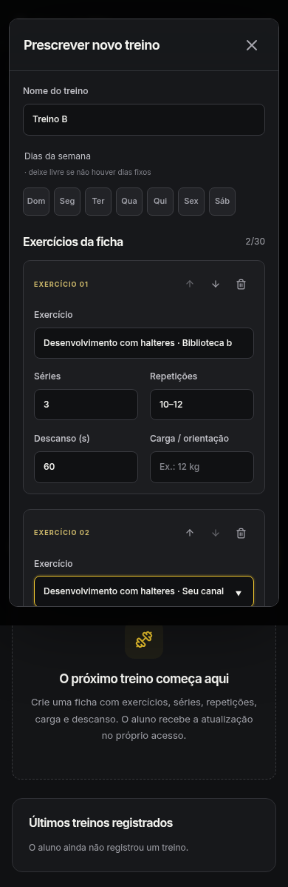
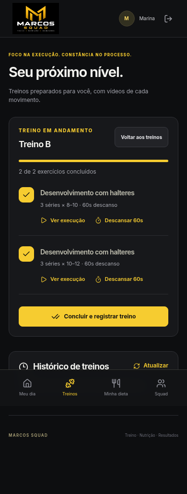
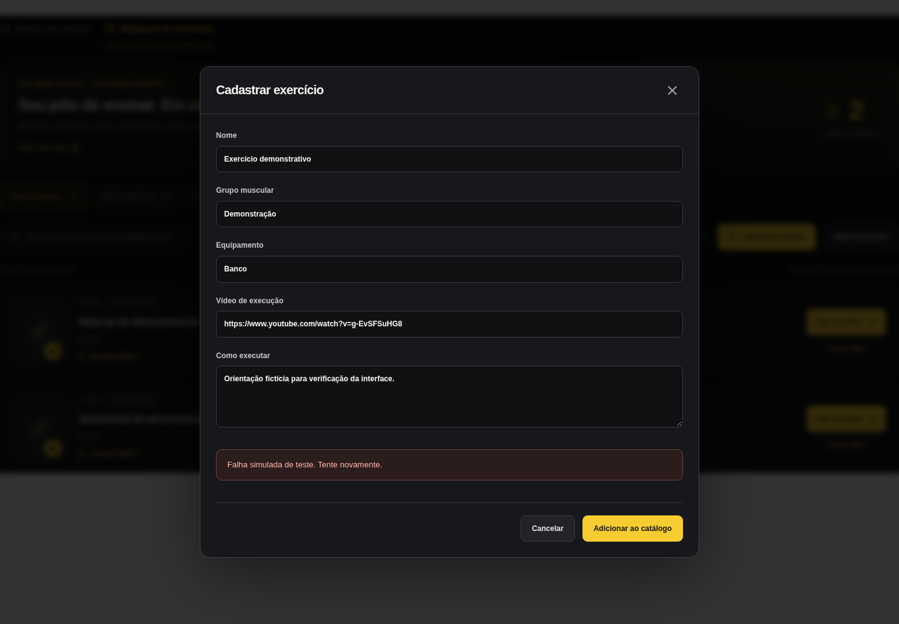

# Revisão dos formulários e da seleção de exercícios — 27/10/2026

A revisão corrigiu a escolha entre cadastros de mesmo nome e preservou o preenchimento dos formulários durante salvamento e recuperação de erro. A biblioteca continua com 73 Shorts confirmados do canal do Marcos, 45 exercícios anteriores e 591 alimentos TACO.

## Escolher o exercício ou alimento correto

Ao prescrever um exercício com nome repetido, a lista distingue a origem. Por exemplo, **Rosca martelo · Seu canal** e **Rosca martelo · Biblioteca base** apontam para cadastros e demonstrações diferentes. A ficha grava o ID escolhido e o conserva quando o professor edita séries ou repetições.

Alimentos com o mesmo nome também mostram a fonte, como **TACO** ou **Personalizado**. Equipamento, categoria ou uma identificação de opção complementam o texto quando necessário. Um nome ambíguo permanece sem seleção até o professor escolher uma opção da lista. Os nomes exibidos na ficha e nos treinos permanecem os nomes dos exercícios; a origem ajuda na escolha do cadastro.

O campo conserva o texto parcial ao mover ou remover outras linhas. Seu nome acessível é estável, e as orientações ficam associadas ao campo para leitores de tela.

## Salvar e recuperar o preenchimento

Os cadastros de exercícios e alimentos e a troca de vídeo bloqueiam seus campos durante o envio. O modal permanece aberto enquanto o salvamento está pendente, inclusive ao tentar fechar, cancelar, pressionar Escape ou clicar fora dele.

Se a requisição falha, os valores continuam preenchidos e os campos voltam a permitir edição. O professor pode corrigir e tentar novamente. As verificações com erro 503 simulado confirmaram que cada tentativa explícita envia os valores correspondentes uma vez.

## Checklist do aluno

Cada marcação identifica o exercício pelo nome para leitores de tela, inclusive depois de marcado. A tecla Espaço alterna a marcação quando o campo está em foco. Enquanto a conclusão é registrada, o checklist fica bloqueado; uma falha preserva as marcações para nova tentativa.

O título do exemplo em andamento continua **Treino B**, usando o nome definido para a ficha.

## Verificação

- **130 testes automatizados passaram, sem falhas**, incluindo três testes focados nas escolhas de catálogo. ESLint e build React/TypeScript passaram.
- Quatro verificações completas passaram em desktop e celular com a interface compilada, a API Node e PostgreSQL/PGlite local: seleção das origens, edição preservando IDs, entrega dos vídeos correspondentes ao aluno e conclusão persistida do checklist.
- Verificações focadas do seletor passaram em 1440 px e 390 px, incluindo rascunhos, reordenação, exclusão e recuperação após erro.
- Verificações de interface com respostas simuladas confirmaram o bloqueio e a recuperação dos formulários de exercício, alimento e vídeo, além dos nomes acessíveis e do bloqueio do checklist durante o registro.

As evidências usam dados fictícios e não apresentaram erros JavaScript. O teste de entrega dos links confere o vídeo associado ao exercício; a reprodução remota do YouTube continua pendente de validação online. As rodadas anteriores são registradas separadamente no [relatório de testes](TESTES_SUPABASE_VERCEL.md).

## Telas de demonstração

## Publicação

A conexão operacional do Supabase permanece adiada a pedido do usuário, para continuar as melhorias do app. Nenhum deploy foi executado nesta rodada. A publicação real e a verificação da conexão ainda precisam ser concluídas; consulte o [estado da publicação](PUBLICACAO_STATUS.md).
