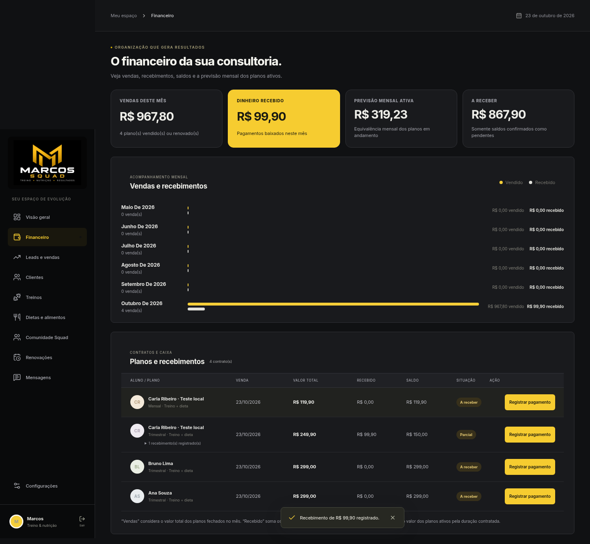
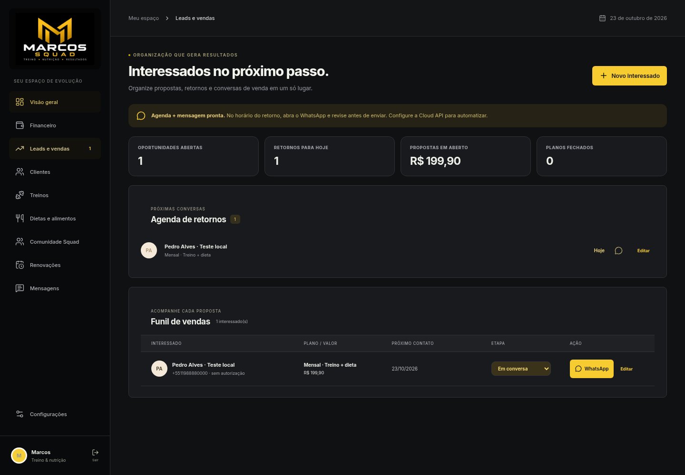
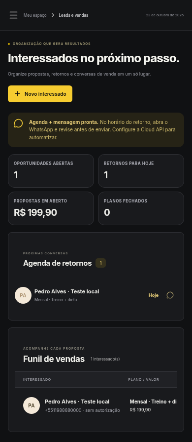

# Revisão dos fluxos e da interface — 23/10/2026

A configuração da conexão Supabase foi adiada a pedido do usuário. Esta revisão usa a interface React compilada e a API Node/Vercel em um ambiente local isolado, com PostgreSQL/PGlite e dados fictícios. Os testes de falha e concorrência usam respostas controladas no Chromium. Não foi realizado deploy nem validada uma conexão de produção.

## Correções verificadas

| Caso reproduzido | Comportamento após a correção |
| --- | --- |
| Atualização periódica antiga chegava depois de uma edição no painel | A resposta antiga é descartada e o cadastro atualizado permanece visível. |
| Resposta antiga do feed chegava depois da nova publicação | A publicação mais recente permanece na tela. |
| Texto da próxima publicação ou comentário era digitado enquanto um envio anterior terminava | O novo rascunho é preservado. |
| Dois envios síncronos do mesmo formulário da comunidade | Apenas um POST é iniciado. |
| Foto válida com 1 × 4000 pixels | A imagem é convertida em JPEG válido, com largura mínima de um pixel. Arquivos inválidos exibem erro e permitem tentar outra foto. |
| Gravação do professor concluída, seguida de falha ao recarregar a prescrição | O aviso informa que salvou e oferece Atualizar; a criação não é reenviada. |
| Professor adicionava exercício ou alimento usado na nova prescrição | Atualizar no aluno também recarrega o catálogo, preservando nomes, vídeos e valores nutricionais. |
| Treino aberto era alterado ou removido pelo professor | Atualizar reconcilia a versão. A versão igual preserva marcações e descanso; uma edição limpa o progresso antigo e mostra aviso; a remoção volta à lista. |
| Conclusão retornava conflito de versão | Atualizar treino permite recuperar a prescrição atual. |
| Resposta de perfil ou inicialização terminava depois da saída ou expiração | A interface continua sem sessão e o novo login carrega somente os dados da sessão atual. |
| Tabela de vendas mantinha fundo claro com texto quase branco | Nomes, valores e etapas têm cores legíveis no tema escuro. |

Também passaram recuperação após falha de curtida ou leitura do feed, descarte de respostas após sair da comunidade e uso no celular sem rolagem horizontal da página.

Na tela de vendas, os textos amostrados dos indicadores, nome, telefone, oferta e etapa apresentaram contraste mínimo de 7:1 após a correção. A página no celular foi conferida com viewport e largura de conteúdo de 390 pixels; a tabela mantém sua própria rolagem para acessar as colunas restantes. Essa medição é específica dos elementos verificados, sem afirmar uma auditoria de acessibilidade de todo o aplicativo.

## Cadastro, financeiro e vendas

Os oito fluxos abaixo foram executados pelo formulário e pelos controles da interface. As gravações e leituras usaram a API real da aplicação e o PostgreSQL/PGlite local:

1. Cadastro vazio bloqueado com mensagens de nome, telefone e valor.
2. Cadastro trimestral com vencimento calculado e valor total de R$ 249,90.
3. Edição e busca do cliente salvo.
4. Preparação do link de WhatsApp; a abertura externa foi interceptada. Nenhuma mensagem foi enviada.
5. Renovação antecipada com preservação da vigência e contrato novo de R$ 119,90.
6. Recebimento parcial de R$ 99,90, com saldo de R$ 150,00 no contrato de R$ 249,90.
7. Quitação do saldo e manutenção da situação Quitado após recarregar a página.
8. Cadastro de interessado e alteração da etapa para negociação.

Não foram observados erros de JavaScript ou respostas HTTP de falha nesses fluxos. Os ensaios separados de recuperação injetam falhas HTTP de propósito e verificam a mensagem e a possibilidade de tentar novamente.

## Telas com dados fictícios

