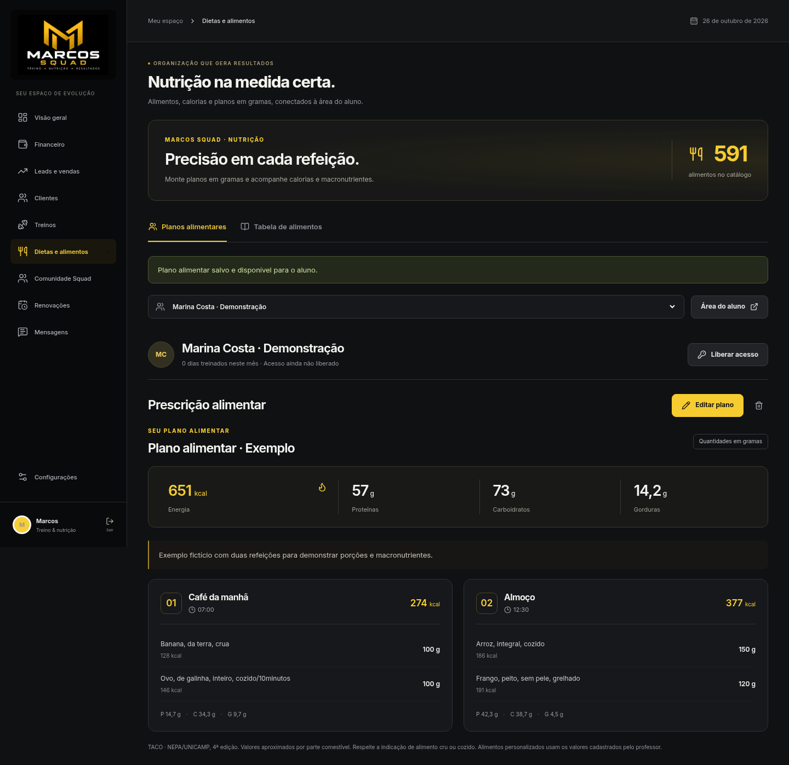
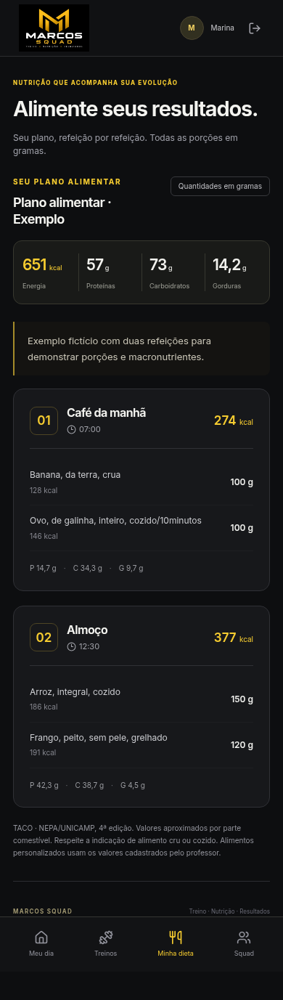

# Verificação antes da publicação — 26/10/2026

| Verificação | Resultado |
| --- | --- |
| Testes automatizados | 127 passaram; 0 falhas |
| Chromium desktop e celular — rodada anterior | 18 verificações passaram |
| Biblioteca de Shorts — rodada atual | 6 verificações adicionais passaram em desktop e celular |
| Fichas completas de treino e dieta | 5 verificações passaram; 33 respostas da API com sucesso |
| Player dos Shorts | ID real e formato vertical conferidos; reprodução remota ainda não validada |
| Respostas atrasadas na seleção de aluno | Troca A → B → A mantém a prescrição atual |
| Erros de JavaScript | 0 |
| Requisições falhas no fluxo visual | 0 |
| Compilação React/TypeScript | Aprovada |
| ESLint | Aprovado |
| Schema Supabase remoto | 20 tabelas com RLS, sem acesso anônimo |
| Gravação no Supabase remoto | Não executada: solicitação recusada |
| Deploy Vercel | Não executado nesta revisão |
| Variáveis remotas Vercel | Lista vazia; configuração pendente |

Os fluxos locais usaram PostgreSQL/PGlite real em memória, a função Node da Vercel e o React compilado para publicação. Os clientes, códigos, prescrições e publicações eram fictícios. Nenhum dado pessoal real ou credencial de produção foi usado.

Na rodada anterior, foram exercitados login do professor, dashboard, treino e dieta por aluno, moderação, acesso individual, isolamento do painel, reprodução MP4, descanso, checklist, conclusão, histórico, ranking, dieta em gramas e comunidade com postagem, curtida e comentário. As telas foram verificadas em 1440 px e 390×844, sem rolagem horizontal.

Na rodada da biblioteca de Shorts, foram verificados estes seis fluxos com a interface compilada, a API Node e PostgreSQL/PGlite locais:

1. Abertura de Treinos na biblioteca, com 73 Shorts e 45 exercícios anteriores, sem IDs ou nomes repetidos na coleção dos Shorts.
2. Busca e filtro encontrando Step-up, com o ID real do vídeo no player vertical.
3. “Usar no treino” pedindo a seleção do aluno, preenchendo o exercício e salvando uma ficha com dois IDs reais dos Shorts.
4. Revisão de importação e envio de dois links já cadastrados, sem duplicação ou substituição dos registros existentes.
5. Uso da biblioteca em tela de 390 px, sem rolagem horizontal da página.
6. Área do aluno recebendo os mesmos exercícios, checklist exigindo ambos e conclusão persistida, mantendo o isolamento do painel do professor.

Nenhum erro de JavaScript foi observado nessa rodada. O iframe do YouTube foi interceptado apenas para conferir URL e dimensões; isso não comprova a reprodução remota. As miniaturas exibiram o fallback quando a rede não forneceu a imagem. Os links públicos e a reprodução no ambiente online precisam ser conferidos depois da implantação. A [documentação da biblioteca](BIBLIOTECA_SHORTS.md) registra a cobertura dos 73 Shorts.

As correções adicionais preservam o estado de liberação do acesso após falha de recarga e evitam que a exclusão de uma linha transfira o texto parcial para outra linha dos editores de treino e dieta. Durante o salvamento, os controles dos editores ficam bloqueados.

Uma rodada separada com seis verificações de acesso passou sem erros JavaScript: liberação e revogação seguidas de falha de leitura mantêm o estado correto; a rotação exige confirmação; cancelar não envia gravação; atualizar repete somente a leitura; e clipboard indisponível orienta a cópia manual. Nos editores, também foram conferidos rascunhos parciais ao mover ou excluir linhas, bloqueio durante o envio e recuperação da edição após erro.

## Fichas completas: professor → aluno

Uma nova rodada concluiu cinco verificações com cliente fictícia, API Node, PostgreSQL/PGlite local e Chromium em 1440 px e 390 px. As 33 respostas da API observadas tiveram sucesso e não houve erro JavaScript.

1. O professor criou **Treino B**, com dois exercícios, dias da semana, séries, repetições, carga e descanso. A reordenação foi mantida na gravação.
2. O professor criou um plano fictício com duas refeições, horários e quatro alimentos. Os totais foram comparados a um cálculo independente a partir das porções.
3. A liberação do acesso e a cópia do texto individual foram conferidas, mantendo o código fora das evidências públicas.
4. No celular, o aluno recebeu os exercícios na ordem salva, concluiu o checklist e registrou o treino; a sessão de aluno não autorizou o painel do professor.
5. A dieta manteve alimentos, porções e macros após recarregar. O exemplo totalizou 650,8 kcal, 57 g de proteínas, 73 g de carboidratos e 14,2 g de gorduras; a interface arredonda a energia para 651 kcal.

O título em execução usa somente o nome escolhido para a ficha. A prévia foi atualizada para **Treino B**.

Os testes de importação detectaram e levaram à correção de leitura inconsistente de uma origem SQLite ativa e importação de contratos/pagamentos de demonstração. As regressões passaram. O histórico financeiro de clientes reais excluídos é conservado.

A etapa seguinte de desenvolvimento acrescentou correções e verificações de rascunhos, fotos, respostas atrasadas, catálogo e treino ativo, além de oito fluxos de cadastro, financeiro e vendas. Consulte [revisão dos fluxos e da interface](REVISAO_INTERFACE.md). A configuração remota foi adiada a pedido do usuário.

A migração foi aplicada ao Supabase e a estrutura conferida por consulta de leitura. O teste remoto de escrita foi recusado. A conexão operacional Vercel–Supabase e o aplicativo online ainda não foram validados.

Repetir com npm test, npm run lint e npm run build. npm run preflight informa as configurações ausentes sem revelar valores; --database acrescenta consultas somente de leitura. Após publicar, executar npm run verify:deployment -- https://URL-CONFIRMADA.

## Telas com dados fictícios

## Biblioteca de Shorts com dados fictícios

