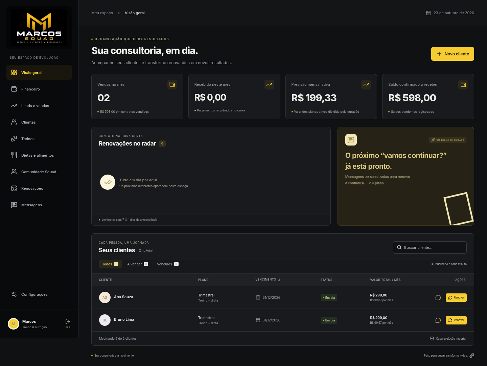
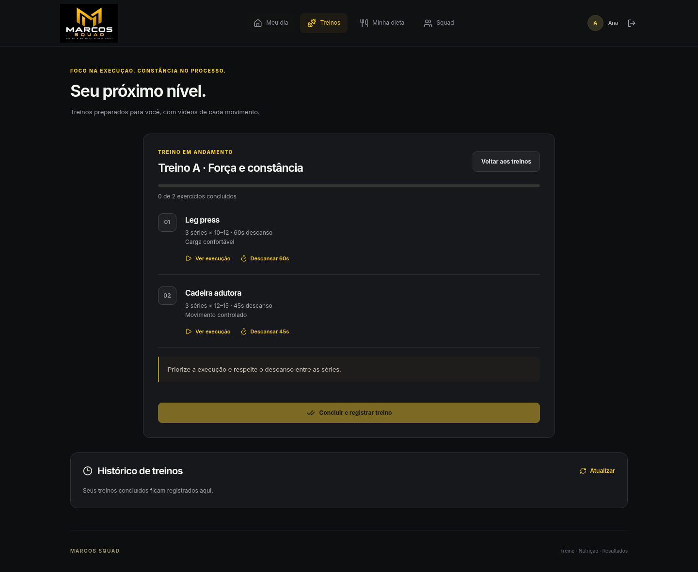
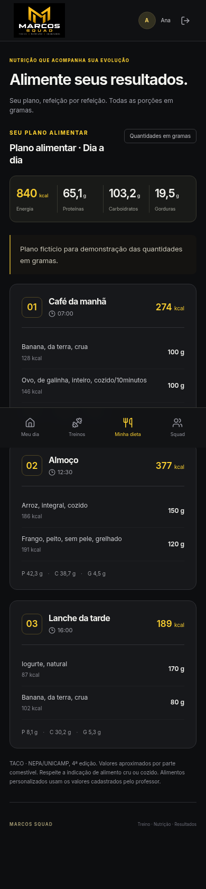

# Verificação antes da publicação — 23/10/2026

| Verificação | Resultado |
| --- | --- |
| Testes automatizados | 109 passaram; 0 falhas |
| Chromium desktop e celular | 18 verificações passaram |
| Respostas atrasadas na seleção de aluno | Troca A → B → A mantém a prescrição atual |
| Erros de JavaScript | 0 |
| Requisições falhas no fluxo visual | 0 |
| Compilação React/TypeScript | Aprovada |
| ESLint | Aprovado |
| Schema Supabase remoto | 20 tabelas com RLS, sem acesso anônimo |
| Gravação no Supabase remoto | Não executada: solicitação recusada |
| Deploy Vercel | Não executado nesta revisão |
| Variáveis remotas Vercel | Lista vazia; configuração pendente |

Os fluxos locais usaram PostgreSQL/PGlite real em memória, a função Node da Vercel e o React compilado para publicação. Os clientes, códigos, prescrições e publicações eram fictícios. Nenhum dado pessoal real ou credencial de produção foi usado.

Foram exercitados login do professor, dashboard, treino e dieta por aluno, moderação, acesso individual, isolamento do painel, reprodução MP4, descanso, checklist, conclusão, histórico, ranking, dieta em gramas e comunidade com postagem, curtida e comentário. As telas foram verificadas em 1440 px e 390×844, sem rolagem horizontal.

Os testes de importação detectaram e levaram à correção de leitura inconsistente de uma origem SQLite ativa e importação de contratos/pagamentos de demonstração. As regressões passaram. O histórico financeiro de clientes reais excluídos é conservado.

A etapa seguinte de desenvolvimento acrescentou correções e verificações de rascunhos, fotos, respostas atrasadas, catálogo e treino ativo, além de oito fluxos de cadastro, financeiro e vendas. Consulte [revisão dos fluxos e da interface](REVISAO_INTERFACE.md). A configuração remota foi adiada a pedido do usuário.

A migração foi aplicada ao Supabase e a estrutura conferida por consulta de leitura. O teste remoto de escrita foi recusado. A conexão operacional Vercel–Supabase e o aplicativo online ainda não foram validados.

Repetir com npm test, npm run lint e npm run build. npm run preflight informa as configurações ausentes sem revelar valores; --database acrescenta consultas somente de leitura. Após publicar, executar npm run verify:deployment -- https://URL-CONFIRMADA.

## Telas com dados fictícios

